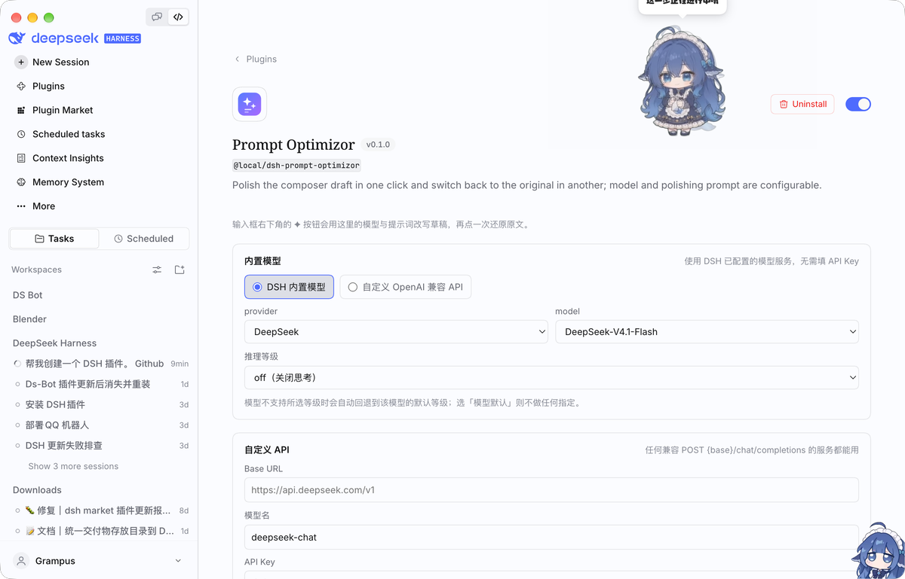

# Prompt Optimizor

A [DeepSeek Harness](https://github.com/deepseek-ai/deepseek-harness) plugin that puts a small ✦ button next to the composer: one click rewrites the draft into a tighter prompt with the model you pick, a second click puts the original back.

[中文说明 →](README.zh.md)

## What it does

- Adds a **✦** button to the composer's right-hand control row.
- **Click once** — the current draft is sent to the configured model and replaced in place with the polished prompt. The button turns into "restore".
- **Click again** — the draft goes back to exactly what it was before the first click.
- **Click while a request is running** — cancels it; the draft is left alone.
- Drafts that contain attachment or `@`-reference placeholders are skipped with a hint instead of being rewritten, so references are never dropped.
- Ships its own settings panel under **Plugins → Prompt Optimizor**.

## Install

```sh
dsh plugin add github:Grampusworld/dsh-prompt-optimizor
```

From a local checkout, use the plugin manager instead:

```text
plugin_manager action=install_bundle target=/absolute/path/to/dsh-PromptOptimizor
```

Reload after editing the source: disable and re-enable the plugin (or refresh the page).

## Settings

| Field | Meaning | Default |
| --- | --- | --- |
| Mode | `Built-in model` (uses the models already configured in Harness, no API key needed) or `Custom OpenAI-compatible API` | Built-in |
| provider / model | Used in built-in mode; the list comes from Harness' own model catalog | `deepseek-official` / `deepseek-flash` |
| Reasoning effort | `Model default` / `off` / `low` / `high` / `max`; falls back to the model's default when unsupported | `off` |
| Base URL / Model name / API key | Used in custom mode; any service that accepts `POST {base}/chat/completions` | empty / `deepseek-chat` / empty |
| Polishing prompt | System instruction sent to the model; saving an empty value restores the default | built-in "prompt compressor" prompt |
| Max characters | Requests above this are refused with a hint instead of being sent | 8000 |
| Request timeout | Milliseconds | 60000 |

**Save and test** saves first, then runs a sample prompt end to end and shows the before/after.



## How it works

- **Host half** (`index.js`) registers `/api/prompt-optimizor/{state,catalog,optimize,test}`. The routes accept loopback peers only, require `application/json` on POST, and cap request bodies at 256 KiB. Two polishing paths:
  - built-in mode streams through `ctx.llm.stream`, so it uses the providers Harness already has;
  - custom mode fetches any OpenAI-compatible `/chat/completions` endpoint.
- **Browser half** (`client.js`) mounts the button into `conversation.input.right` (rewriting the draft through `inputActions.setDraft`) and the settings panel into `plugins.bundle.config`.
- Configuration is read and written through the `settings` service under the namespace `dsh-prompt-optimizor`; the schema is declared with `schemastery`, so no manual `package.json` or `cordis.patch.yml` edits are needed.

## Privacy

The API key is stored in your local Harness profile configuration and is never sent back to the page — `GET /api/prompt-optimizor/state` only answers `hasApiKey`. Requests go from your machine straight to the provider you configured.

## Development

```sh
node --check index.js && node --check client.js
```

## License

MIT.
